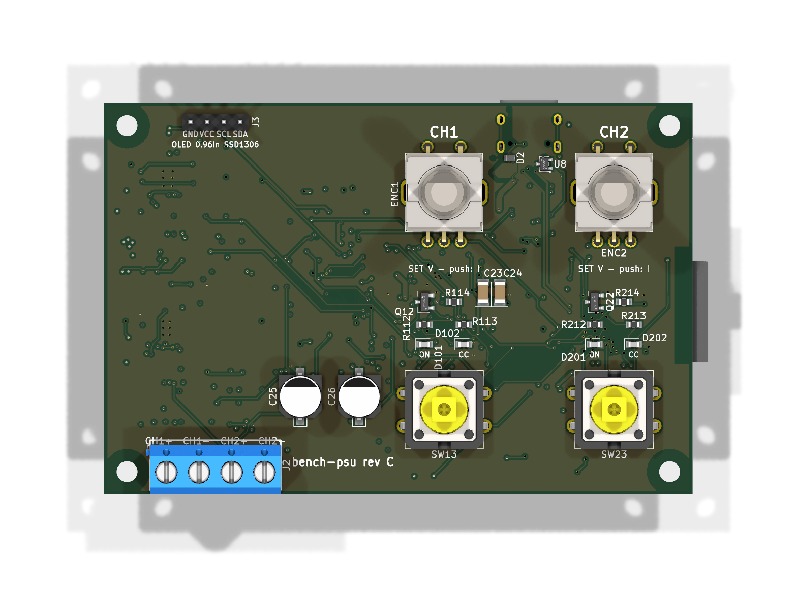
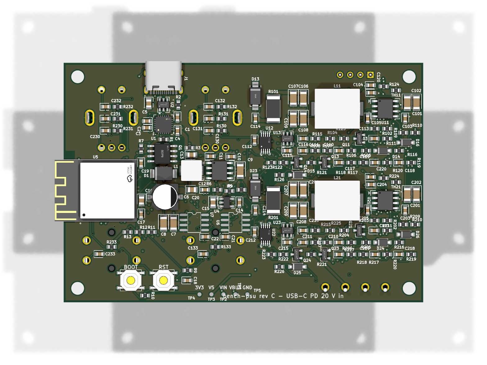

# vibepcb-bench-psu

USB-C PD (20 V) powered bench supply, 2 independent channels, 1.6-16.6 V / 3 A each, constant voltage / constant
current, designed with [VibePCB](../VibePCB). Board: `boards/bench-psu` (rev C: 90 x 60 mm, 4 layers, parts on both
sides). Design rationale is also in the header of `boards/bench-psu/index.circuit.tsx`.

The board is the front panel: the top carries what a user touches (0.96" OLED module, per channel an encoder and an
ON/OFF button, ON / CC LEDs, the output terminal), the bottom carries all electronics.

```
USB-C PD (STUSB4500, 20 V) -> P-FET -> VIN
   VIN -> 5 V buck (LMR33630) -> 3.3 V LDO -> ESP32-S3-MINI-1 (I2C, PWM, PCNT, ADC, BLE, native USB)
   VIN -> LMR33630 buck (x2) -> 20 mR shunt (INA226 + INA181) -> output terminal (CH1, CH2)
ESP32 PWM -> RC -> op-amp/NPN current sink on FB            = voltage set point (CV)
ESP32 PWM -> RC -> differential PI integrator -> diode -> FB = current limit (CC), vs INA181 (1 V/A)
INA226 ALERT -> buck EN = hardware over-current trip (backstop)
per channel: EC11 encoder (turn: set, push: V <-> I), ON/OFF button, ON LED (= EN), CC LED (GPIO),
             output discharge (2N7002 + 4.7k while off), SS54 reverse diode, FB clamp, NTC on the converter
USB D+/D-: 90 Ohm pair on the top layer (USBLC6 -> ESP32)
J3: SSD1306 0.96" I2C OLED module (bought separately, see "Parts bought separately")
```

## Look at it (`boards/bench-psu/hardware/`)

| What | File |
|------|------|
| Schematic | [bench-psu-schematic.pdf](boards/bench-psu/hardware/bench-psu-schematic.pdf) |
| Top view (3D) | [bench-psu-top.png](boards/bench-psu/hardware/bench-psu-top.png) |
| Bottom view (3D) | [bench-psu-bottom.png](boards/bench-psu/hardware/bench-psu-bottom.png) |
| Layout | [front](boards/bench-psu/hardware/bench-psu-layout-front.svg), [back](boards/bench-psu/hardware/bench-psu-layout-back.svg), [PDF](boards/bench-psu/hardware/bench-psu-layout.pdf) |
| KiCad project (open the `.kicad_pro`) | [kicad/](boards/bench-psu/hardware/kicad/) |
| BOM (JLCPCB format, LCSC + MPN) | [bench-psu-bom.csv](boards/bench-psu/hardware/bench-psu-bom.csv) |

Fab files (Gerbers + drill, BOM, CPL, bring-up sheet, firmware pin header) are generated, not committed:
`hatch run pcb fab bench-psu` writes them to `out/bench-psu/fab/` (it refuses unless `check --strict` passes).




## Design decisions

- **Parts:** everything in LCSC stock (checked 2026-10-25 with `hatch run pcb cost bench-psu`); basic-library passives
  wherever the value exists. Two-sided assembly: all SMD on the bottom except the status LEDs and their drivers;
  the front-panel parts (encoders, buttons, OLED header, terminal) are through-hole and hand-soldered.
- **Form factor:** 90 x 60 mm: the front-panel parts are through-hole, so their pins also take
  room on the bottom; 90 mm is what the two channel blocks, the control columns and the ESP32 need side by side.
  4 x M3 holes at (+-41.5, +-26.5) mm from the centre, keepouts for screw heads in `vibepcb.toml`.
- **Plain buck, not buck-boost:** the PD input (20 V) is always above the output (max 16.6 V).
- **Converter:** LMR33630A per channel (synchronous, 3 A, 400 kHz, HSOIC-8 with exposed pad, 36 V input),
  15 uH / 7 A sat FXL1040-150 inductor (TI's L_MIN is 11.6 uH at 16.6 V / 400 kHz), 4 x 22 uF/25 V ceramic output +
  100 uF electrolytic at the terminal (C25 / C26: the ceramics derate to ~18 uF at 16 V while the loop gain stays the
  same), 2 x 10 uF/50 V + 220 nF/50 V input.
  **Thermal vias** (2 x 3, 0.3 mm, `[thermal_vias.*]`) in every LMR33630 exposed pad; the pad connects solid to the
  pours.
- **Voltage setting, fail-safe:** an op-amp (TLV9062) + NPN sinks Ic = Vc / 2.2k from the feedback node,
  Vc = PWM (14-bit, 2-pole RC) * 10k/120k (R106 + R107 + R108): Vout = 1.6 V + 4.55 * Vpwm, i.e. 1.6 V at 0 V / floating PWM or MCU reset,
  16.6 V at 3.3 V PWM (the hardware maximum), ~0.9 mV per step. Feedback is taken at the terminal, after the shunt.
  Firmware closes the loop on the INA226 bus-voltage reading.
- **Loop compensation:** the FB network has a feedback gain of 0.625 at every output voltage, but the LMR33630's
  internal compensation expects 1 V / Vout: unstable without help. 6.8k + 220 nF from FB to GND (lag network) lowers
  the gain above ~100 Hz: phase margin 93-98 deg, crossover 9-38 kHz (simulated; see the open point on the lowest
  phase below crossover in "Status").
- **FB clamp (rev C, from the review):** the buck can't pull its output down, so after a set-point drop or a lost PWM
  (MCU reset) FB would sit at 0.625 x OUT, up to 10.4 V against a 5.5 V absolute maximum, for seconds. A 1N4148W per
  channel (D16 / D26, FB -> 3V3) holds it at ~3.8 V (`sim/powerup_ch.cir`); in operation it is reverse-biased (nA).
- **Start-up:** the lag capacitor is pre-charged to ~1.3 V while the channel is off (1N4148W + 100k from the
  discharge-gate node); otherwise the soft start charges it through the 120k top resistor and every enable overshoots
  to ~7.7 V. With EN high the diode blocks: no offset. Overshoot 0.02 % (`sim/powerup_ch.cir`).
- **Constant current:** INA181A2 (x50) on the shunt = 1 V/A; ISET = PWM, 2-pole RC, 1 V/A; a TLV9062 half as a
  differential PI integrator (10k, 330 R + 100 nF in both legs) sources current into FB through 10k + 1N4148W when
  I > Iset. Differential, because the plant gain into a short is ~240: a plain non-inverting PI keeps a
  high-frequency gain >= 1 and oscillates. Simulated phase margin >= 91 deg from a short to 5 R, a 20 R -> 2 R step
  settles in 1.7 ms (`sim/cc_loop.cir`). In CV the amp rests at 0 V, the diode is off. Into a hard short the
  converter may hiccup once before the loop holds (current limited either way).
- **Enable / current trip:** ESP32 drives each buck's EN through 10k (100k pull-down: off at reset). The INA226 ALERT
  (shunt over-limit, latched) pulls EN low directly: the hard backstop, at a ceiling the firmware sets above Iset.
- **Output:** 100 nF at the terminal (INA226 VBUS); SS54 reverse diode (a reversed source is clamped); active
  discharge while off (2N7002 + 4.7k, gate from 5 V, held off by an NPN while EN is high): "off" is below 0.5 V within
  ~2 s (~60 s through the divider alone), also at reset and after a trip.
- **Cooling: passive.** ~2-2.5 W per channel at 3 A (1.2-1.6 W in the IC, datasheet-maximum Rds(on)). With the thermal
  vias Tj stays below 112 C at 45 C ambient (35 C room + 10 K in a vented enclosure; ~160 C without vias,
  `sim/buck_loadpoints.cir`). A 10k NTC
  (Murata NCP18XH103F03RB) next to each converter feeds ESP32 ADC1 (IO1 / IO2) for firmware derating; the converter's
  thermal shutdown is the last resort. No fan.
- **Measurement:** INA226 per channel (0x40 CH1, 0x41 CH2), 20 mR shunt: 4.096 A full scale, 125 uA / 1.25 mV LSB,
  60 mV drop and 0.18 W at 3 A.
- **Input protection:** ESDA25P35 TVS on VBUS at the connector (ahead of Q1: the STUSB4500's VDD is rated 28 V),
  ESDA25W ESD array on CC1 / CC2 as in ST's reference; D+/D- through the USBLC6. The connector shell goes to GND
  through 1 MOhm || 4.7 nF rated 1 kV (an 8 kV / 150 pF shell discharge charges it to ~250 V).
- **USB data:** D+/D- run from the USBLC6 to the ESP32 as a coupled pair on the top layer over the In1 GND plane,
  0.32 / 0.2 mm = 90 Ohm differential (JLC04161H-7628 stack-up), two vias per line; drawn as a fixed path in the TSX
  (tscircuit's router does not couple pairs). Full Speed USB would work uncoupled too; this is the standard layout.
- **Input:** STUSB4500 drives the AO4407A gate through 47k against 100k gate-source (Vgs stays inside +-25 V up to the
  TVS clamp), 100 nF gate-source for a slow turn-on. SMBJ22A TVS (35.5 V clamp, below the LMR33630's 38 V abs max),
  100 uF SMD electrolytic for damping.
- **Logic supply:** 5 V buck (same LMR33630, 6.8 uH / 4 A sat FXL0530, 4 x 22 uF output, two of them on the top side)
  -> AP2112K 3.3 V; native USB on the ESP32 for flashing / CDC.
- **Front panel:** EC11E15244B2 encoders (counted by the S3's PCNT units), Omron B3F-4055 12 mm buttons (wired on
  diagonal pads 1 / 4: always across the contact), 3.3k pull-up + 33 nF on every front-panel line (1 mA contact
  current, the EC11's minimum for contact wetting). 0.96" SSD1306
  I2C module (0x3C) on J3, its content is firmware.
- **Status LEDs:** ON (yellow-green) follows the converter's EN node through an NPN (hardware truth, dark after an
  INA226 trip); CC (red) is a GPIO (IO21 / IO47) the firmware lights while the channel is current-limited.
- **Antenna:** the ESP32-S3-MINI-1 (bottom) points its antenna at the +x board edge; no copper under it on any layer.

## History

Rev A (first draft) used a TSOT-23 converter at 1.1 MHz, injected the PWM straight into FB (0 V PWM = 18 V out) and had
no hardware current trip. Rev B moved to the LMR33630 with the fail-safe current-sink voltage setting, the INA226 trip
and the FB lag network. Rev C (this board):

| rev B | rev C | why |
|-------|-------|-----|
| 90 x 76 mm, everything on top | 90 x 60 mm, front panel on top, electronics on the bottom | the board is the front panel; smaller |
| OLED + KY-040 encoder as modules on headers | OLED module on J3, per channel EC11 encoder + ON/OFF button on the board | per-channel controls |
| current trip only (INA226 ALERT -> EN) | CC loop (INA181 + differential PI into FB) + the trip as backstop | a real current limit instead of switching off |
| lag capacitor starts discharged | pre-charged while off (1N4148W + 100k) | 7.7 V overshoot at every enable (simulated) |
| output decays over ~28 s when off | 2N7002 + 4.7k discharge while EN is low | "off" means 0 V |
| no reverse protection | SS54 across each output | reversed source / battery clamped |
| no thermal vias | 2 x 3 via grid in each exposed pad | Tj ~160 C -> 112 C at 45 C ambient, 3 A |
| no temperature sensing, no mounting holes | NTC per converter on ADC1, 4 x M3 | firmware derating with passive cooling; enclosure |
| sim decks run by hand | 5 decks run by `check`, pass ranges with sources | verification is enforced |
| 2.4k sink resistor: Vout_max 15.2 V | 2.2k: 16.6 V | review: R106 in series with the VSET divider |
| 10 uH channel / 15 uH (1.65 A sat) logic inductors | 15 uH / 7 A sat, 6.8 uH / 4 A sat | below TI's L_MIN; saturating below the current limit (review) |
| no TVS / ESD at the USB-C input, 50 V shell cap | ESDA25P35 on VBUS, ESDA25W on CC, 1 kV shell cap | hot-plug and shell ESD (review) |
| ceramics only on the outputs | + 100 uF per output | ceramic capacitance collapses at 16 V (review) |
| FB unprotected | FB clamp to 3V3 | FB at 10.4 V after a set-point drop (review) |
| 10k / 10 nF front-panel lines | 3.3k / 33 nF | encoder contacts below their 1 mA wetting current (review) |
| D+/D- auto-routed | 90 Ohm pair on the top layer | standard USB layout |

## Simulations (`boards/bench-psu/sim/`, run by `hatch run pcb check`)

Each deck declares what it proves (`* covers:`) and its pass ranges with their source (`* range:`, datasheet /
intent / house defaults); `check` runs ngspice, compares the deck's R/C values with the board and judges the results.

| Deck | Covers | Result |
|------|--------|--------|
| `buck_loop.cir` | CV loop U11 / U21 | phase margin 93-98 deg at crossover (1.6-16 V; >= 63 deg for C25/C26 ESR 0.05..1 Ohm), 2 A step <= 251 mV (intent: 400 mV) |
| `cc_loop.cir` | CC loop | phase margin >= 91 deg (short .. 5 R), settles in 1.7 ms, current error < 0.01 % |
| `powerup_ch.cir` | power-up U11 / U21 | overshoot 0.02 %, settles 13.5 ms after EN, 16.60 V at full PWM, FB <= 3.8 V after a set-point drop |
| `powerup_logic.cir` | power-up U3 / U4 | V5 5.15-5.17 V, V3V3 3.28-3.30 V through a 0.1 -> 0.35 A step |
| `buck_loadpoints.cir` | thermal U11 / U21 | Tj <= 112 C at 45 C ambient (max Rds(on)), inductor peak <= 3.41 A (ISC min 3.85 A) |

Models: averaged peak-current-mode buck with the LMR33630's internal compensation *derived* (not published), COMP
clamp, PFM (no reverse current); switching-level power stage for the load points. Plots and tables:
[sim/README.md](boards/bench-psu/sim/README.md).

## Design review (reviewer agent)

`hatch run pcb review bench-psu --run`: a fresh Claude session, with no access to the design conversation, checks every
part against its datasheet (answers and citations in `boards/bench-psu/review.toml`). Issues get fixed or accepted with
a written reason in `boards/bench-psu/findings.toml`; `check --strict` (needed by `fab`) fails while any is open.

| Round | Items | ok / issue / unknown | Notable catch, and what happened |
|------:|------:|---------------------:|----------------------------------|
| 1 | 178 | 155 / 15 / 8 | max output 15.2 V, not 16.6 V; both inductors too small; no input TVS / ESD - fixed |
| 2 | 185 | 169 / 11 / 5 | output capacitance collapses at 16 V; 100 nF instead of 220 nF HF input caps - fixed |
| 3 | 185 | 171 / 5 / 9 | encoder contacts below their wetting current - fixed |
| 4 | 185 | 171 / 6 / 8 | FB pin over-voltage after a set-point drop - fixed (clamp) |
| 5 | 189 | 176 / 5 / 8 | USB shell capacitor rated 50 V - fixed (1 kV) |
| 6 | 189 | 182 / 4 / 3 | hiccup into a hard short - intent corrected, bring-up test |

Accepted with reasons (see `findings.toml`): L1's 4 A soft saturation on the internal 5 V rail, Q1 gate drive on a 5 V-only
source, the 3 A channel budget at the converter's rating (firmware caps ISET at 3.0 A), J1 at its 3 A rating, LED / TVS
polarity and the ESP32's corner GND pads (verified on the footprint), the OLED module pin order (checked at bring-up),
and the loop stability (rests on unpublished compensation constants: measured on the prototype).

## Pin map (ESP32-S3)

| Pin | Net | Use |
|-----|-----|-----|
| IO8 / IO9 | I2C_SDA / I2C_SCL | STUSB4500 0x28, INA226 0x40 / 0x41, OLED 0x3C (4.7k pull-ups) |
| IO10 | PD_ALERT | STUSB4500 alert (10k pull-up) |
| IO4 / IO5 | PWM1 / PWM2 | voltage set point CH1 / CH2 |
| IO11 / IO12 | ISET1 / ISET2 | current limit CH1 / CH2 (1 V/A after the RC) |
| IO6 / IO7 | EN1_MCU / EN2_MCU | channel enable (through 10k; INA226 ALERT overrides) |
| IO1 / IO2 | NTC1 / NTC2 | converter temperature (ADC1; 10k to 3V3, NTC to GND) |
| IO15 / IO16 / IO17 | ENC1_A / ENC1_B / ENC1_SW | CH1 encoder |
| IO13 / IO14 / IO18 | ENC2_A / ENC2_B / ENC2_SW | CH2 encoder |
| IO38 / IO39 | BTN1 / BTN2 | ON/OFF buttons (low = pressed) |
| IO21 / IO47 | LED_CC1 / LED_CC2 | red CC LED CH1 / CH2 (high = on) |
| IO19 / IO20 | USB_DN / USB_DP | native USB |
| IO0, EN | BOOT, EN_RST | tactile switches (bottom) |

`hatch run pcb fab bench-psu` also writes `bench-psu-pins.h` (net -> pin defines) for the firmware.

## Firmware duties (not part of this repo yet)

- Write the STUSB4500 NVM once over I2C (20 V / 3 A). The factory NVM already asks a 20 V source for 20 V / 1 A
  (PDO3, DS12499 table 18): keep both channels off until the NVM is written.
- **Enable sequence:** PWM (VSET) = 0 before EN high, wait ~5 ms for the soft start, then ramp the set point (>= 5 ms).
  Enabling at a high set point starts at the converter's current limit with no soft start (`sim/powerup_ch.cir`).
- Close the voltage loop on the INA226 bus-voltage reading (PWM -> Vout is ~4.55 V/V, offset trimmed per channel).
- Current limit: ISET PWM = Iset * 1 V/A, capped at 3.0 A (ISET full scale would be 3.3 A; the LMR33630 is rated 3 A); light the CC LED while the INA226 current is within ~2 % of Iset.
  Program each INA226's shunt over-limit (Mask/Enable SOL + LEN latch) to a ceiling above Iset (e.g. Iset + 0.5 A,
  max 3.5 A); after a trip read Mask/Enable (clears the latch) and report it.
- Temperature: NTC (B 3380) -> derate the current limit above ~85 C board temperature, switch off above ~100 C.
- Budget power: the sum of both channels stays inside the negotiated PDO (60 W at 20 V / 3 A).
- UI: encoders via PCNT, push toggles V / I editing; ON/OFF buttons toggle EN; the OLED shows set and measured V / I,
  CV / CC and temperature per channel.

## Bring-up

Bring the board up from the bottom: logic first from a plain 5 V source, then the channels at 5 V input, and 20 V
only after that. The STUSB4500's factory NVM asks a 20 V source for 20 V / 1 A (PDO3), so use a 5 V-only port (a PC
port) until step 4: a PD charger gives VIN = 20 V from the first plug-in. Use a PC port or a USB-C supply you can current-limit; keep a DMM, a scope and a power resistor (a few ohms,
10 W) at hand. `hatch run pcb fab bench-psu` also writes a generated bring-up sheet (`bench-psu-bringup.md`).

Test points (bottom, labelled): TP1 VBUS, TP2 VIN, TP3 V5, TP4 3V3, TP5 GND. Outputs at the terminal (top).

### 0. Unpowered

1. Look: D1 (TVS), C6 / C25 / C26 (electrolytics), D13 / D23 (SS54) polarity, the LEDs the right way round (cathode = pad 2, the side where the silkscreen bracket is open), no solder bridges on
   U5 (ESP32), U12 / U22 (INA226, 0.65 mm pitch), U6 / U7. Thermal vias visible in the LMR33630 pads.
2. Resistance to GND (meter on 2 kOhm+ range, capacitors charge): VBUS, VIN, 5V, 3V3 not shorted; OUT1 / OUT2
   > 100 kOhm (the discharge FET needs its 5 V gate drive, so it is off while unpowered).

### 1. Logic at 5 V

1. Plug a plain USB-C 5 V source (current limit ~300 mA). Idle draw should be well under 100 mA.
2. Measure TP2 VIN ~5 V, TP3 ~4.6 V (buck in dropout), TP4 = 3.3 V. Both ON LEDs dark, both CC LEDs dark.
3. Nothing gets warm.

### 2. Firmware, I2C, front panel

1. Hold BOOT, tap RST, release BOOT (bottom side): the ESP32-S3 enumerates as "USB JTAG/serial debug unit" on the same
   USB-C connector. Flash a test firmware.
2. Before plugging the OLED module in: its header must read GND VCC SCL SDA like J3's silkscreen (modules also ship
   with VCC / GND swapped, which would reverse 3V3 into it). I2C scan: 0x28 STUSB4500, 0x40 / 0x41 INA226, 0x3C OLED. INA226 die ID (0xFF) = 0x2260.
3. Encoders count on IO15/16 and IO13/14, pushes on IO17 / IO18, buttons on IO38 / IO39; CC LEDs on IO21 / IO47.
4. NTC readings (IO1 / IO2) ~1.65 V at 25 C.

### 3. Channels at 5 V input

Each channel alone, no load first. Output range at 5 V input is 1.6 V to ~4.3 V (buck dropout).

1. PWM = 0, ISET = 3.3 V (no current limit), then EN high: ON LED lights, OUTn = 1.6 V, no overshoot on the scope.
2. Step the PWM: Vout = 1.6 V + 4.55 * Vpwm. Note offset / gain per channel for the calibration.
3. EN low: ON LED dark, the output falls below 0.5 V within ~2 s (discharge).
4. CC: set 3 V, ISET = 0.5 V (0.5 A), load 2 Ohm: the output drops to ~1 V, the current reads 0.5 A (INA226 and DMM).
5. Trip: INA226 over-limit 0.3 A with ISET above it: ON LED dark at once, EN = 0 V; reading Mask/Enable clears it.

### 4. 20 V

1. Write the STUSB4500 NVM for a 20 V PDO (with 5 V / 9 V fallback; check the readback), unplug, plug a 20 V PD
   charger (45 W+). VIN = 20 V within ~1 s; 5V = 5.17 V.
2. Per channel, no load: 1.6 V at PWM 0; ramp to ~16.6 V (hardware maximum; firmware caps at 16.5 V).
3. Load steps with the scope on the terminal: 1 -> 3 A at 1.6 V and at 16.6 V: <= ~0.4 V deviation; note the
   recovery time. Ringing that does not settle means less phase margin than simulated: report it.
   Loop gain (the simulation rests on derived, unpublished compensation constants): 10 Ohm in series with R102 / R202
   at the OUT end, inject across it (Bode box or a scope FRA), measure at 1.6 V and 16.6 V, 1 A: phase margin >= 45 deg.
4. CC into a short (thick wire) at Iset 1 A and 3 A: the current settles at Iset within a few ms. The converter may
   hiccup once (off, soft restart) before the CC loop holds: fine; repeated hiccup means the CC loop is too slow - report it.
5. Heat: 3 A at 5 V and 12 V for 10 minutes, in the enclosure if there is one: NTC reading and a thermocouple on the
   LMR33630 case should stay below ~85 C.

## Parts bought separately

- **J3 OLED module:** not stocked at LCSC. Any 0.96" 128 x 64 SSD1306 I2C module (address 0x3C, 3.3 V) whose 4-pin
  header reads **GND, VCC, SCL, SDA** (e.g. LCKFB's 0.96-inch IIC screen). Many modules swap VCC and GND: check before
  plugging it in. SSD1315 look-alikes are mostly compatible; the firmware should know which one it drives.

`hatch run pcb cost bench-psu` prices the rest at LCSC: about $127 in parts for 5 boards (2026-10-25), plus the bare
boards (quote the Gerbers at jlcpcb.com and set `[cost] pcb_usd` in `vibepcb.toml`).

## Status / open items

- Rev C passes `check --strict` (DRC / ERC, house rules, simulations, six review rounds); fab files are ready, no
  prototype yet.
- Loop and CC stability are simulated with an averaged model whose internal-compensation constants are derived, not
  published: measure the load-step, loop gain and short-circuit responses on the first prototype.
- With the 100 uF output bulk the CV loop's lowest phase below crossover is small at high output voltage (9 deg at
  12 V, 2 deg at 16 V; simulated, `sim/README.md`). Not conditionally stable, but little room: bring-up step 4.3
  decides; if the loop rings, a lower-ESR bulk cap or a retuned lag network is the next step.
- Back-feed: a source *above* the set voltage on a channel (e.g. a battery) back-feeds VIN through the high-side FET's
  body diode, and an off channel discharges it through 4.7k. Do not connect batteries / active loads.
- The current loop needs ~2 ms after a step into the limit (integrator rising from 0 V); meanwhile the converter runs
  at its own ~4.5 A peak limit. The INA226 trip is the fast backstop.

## Build

`hatch run setup`, then `hatch run pcb all bench-psu` (build + fix + check; the routed build takes 10+ minutes, run it
in the background). Open `out/bench-psu/kicad/bench-psu.kicad_pro` in KiCad.
