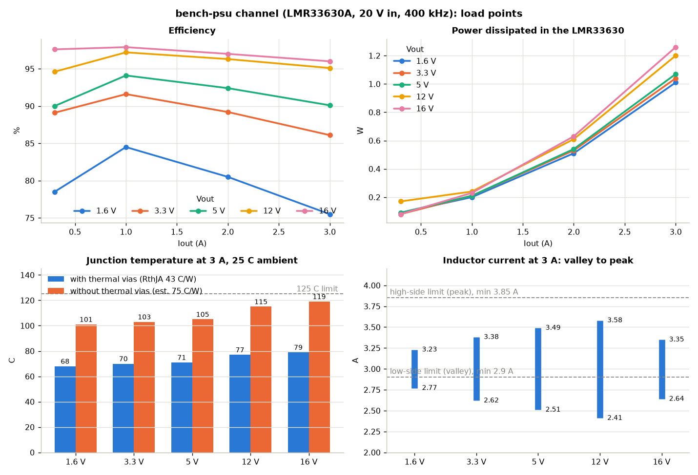
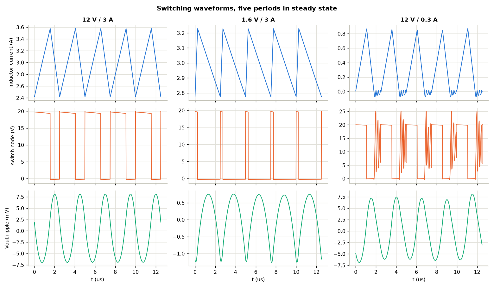
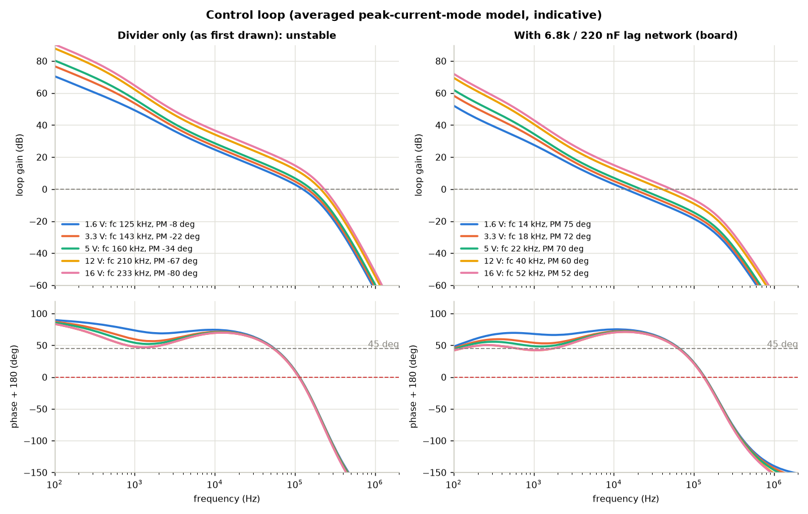
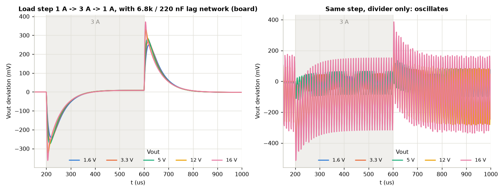
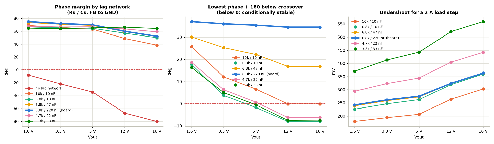

# bench-psu DC/DC simulations (one output channel, LMR33630A)

Run from the repo root: `ngspice -b boards/bench-psu/sim/<deck>.cir`. Model assumptions are in each deck's header.
VIN = 20 V (PD), fsw = 400 kHz, L = 10 uH FXL1040, Cout = 4 x 22 uF/25 V 1206 (DC-bias derated), 20 mOhm shunt,
regulation at the terminal. Results as of rev B (2026-10-21).

## Load points: `buck_loadpoints.cir`

Switching-level power stage, hot Rds_on (x1.3), steady state. Efficiency includes the IC, inductor DCR and shunt
(switching/dead-time/gate losses added analytically, core loss not modelled). Tj at 25 C ambient for
RthJA = 43 C/W (exposed pad with thermal vias, datasheet JEDEC value) and 75 C/W (estimate without thermal vias,
the current board state).

| Vout | Iout | Efficiency | P_loss total | P_IC | iL peak / valley | Ripple at terminal | Tj (43 / 75 C/W) |
|-----:|-----:|-----------:|-------------:|-----:|-----------------:|-------------------:|-----------------:|
| 1.6 V | 0.3 A | 78.5 % | 0.13 W | 0.09 W | 0.49 / 0.11 A | 1.8 mVpp | 29 / 32 C |
| 1.6 V | 1 A | 84.5 % | 0.29 W | 0.20 W | 1.20 / 0.80 A | 1.9 mVpp | 34 / 40 C |
| 1.6 V | 2 A | 80.5 % | 0.78 W | 0.51 W | 2.22 / 1.79 A | 1.9 mVpp | 47 / 64 C |
| 1.6 V | 3 A | 75.5 % | 1.55 W | 1.01 W | 3.23 / 2.77 A | 2.1 mVpp | 68 / 101 C |
| 3.3 V | 0.3 A | 89.1 % | 0.12 W | 0.08 W | 0.67 / DCM | 4.4 mVpp | 29 / 31 C |
| 3.3 V | 1 A | 91.6 % | 0.30 W | 0.21 W | 1.36 / 0.64 A | 4.0 mVpp | 34 / 40 C |
| 3.3 V | 2 A | 89.2 % | 0.80 W | 0.53 W | 2.37 / 1.63 A | 4.4 mVpp | 48 / 65 C |
| 3.3 V | 3 A | 86.1 % | 1.60 W | 1.04 W | 3.38 / 2.62 A | 4.3 mVpp | 70 / 103 C |
| 5 V | 0.3 A | ~90 % | ~0.17 W | 0.09 W | 0.78 / DCM | 6.7 mVpp | 29 / 32 C |
| 5 V | 1 A | 94.1 % | 0.31 W | 0.21 W | 1.48 / 0.52 A | 6.8 mVpp | 34 / 41 C |
| 5 V | 2 A | 92.4 % | 0.82 W | 0.54 W | 2.49 / 1.51 A | 6.8 mVpp | 48 / 66 C |
| 5 V | 3 A | 90.1 % | 1.65 W | 1.07 W | 3.49 / 2.51 A | 6.8 mVpp | 71 / 105 C |
| 12 V | 0.3 A | 94.6 % | 0.21 W | 0.17 W | 0.88 / DCM | 18 mVpp | 32 / 37 C |
| 12 V | 1 A | 97.2 % | 0.34 W | 0.24 W | 1.59 / 0.40 A | 16 mVpp | 35 / 43 C |
| 12 V | 2 A | 96.3 % | 0.92 W | 0.61 W | 2.59 / 1.41 A | 15 mVpp | 51 / 71 C |
| 12 V | 3 A | 95.1 % | 1.87 W | 1.20 W | 3.58 / 2.41 A | 16 mVpp | 77 / 115 C |
| 16 V | 0.3 A | 97.6 % | 0.12 W | 0.08 W | 0.69 / DCM | 14 mVpp | 29 / 31 C |
| 16 V | 1 A | 97.9 % | 0.35 W | 0.23 W | 1.38 / 0.61 A | 14 mVpp | 35 / 42 C |
| 16 V | 2 A | 97.0 % | 0.97 W | 0.63 W | 2.36 / 1.63 A | 13 mVpp | 52 / 72 C |
| 16 V | 3 A | 96.0 % | 1.99 W | 1.26 W | 3.35 / 2.64 A | 12 mVpp | 79 / 119 C |

0.3 A points: diode-emulation (DCM) is modelled, PFM bursts are not; the real part is somewhat better there
(efficiency within a few %). Ripple is the switching ripple of ideal capacitors; ESL and probe ground add spikes.

Reading it:

- **Thermal is the limit, not efficiency.** At 3 A the IC dissipates 1.0-1.3 W. With thermal vias under the exposed
  pad: Tj 68-79 C at 25 C ambient. Without them (current board) 100-119 C, i.e. ~135 C in a 40 C enclosure, close
  to thermal shutdown. Two channels at 3 A also heat each other. The thermal vias are required before ordering.
- **Current limits:** peak 3.58 A max (12 V / 3 A) vs. high-side limit ISC 3.85 A min: OK. Valley 2.41-2.77 A at 3 A vs.
  low-side limit ILIMIT 2.9 A min: OK, but at 1.6 V the margin is 0.13 A. A worst-case part limits the 1.6 V output
  at about 3.1 A.
- Worst efficiency is at low output voltage and full current (75 % at 1.6 V / 3 A): conduction losses of a
  fixed-current path against a small output power.
- Total input at 2 x 16 V / 3 A: 100 W. USB PD 20 V / 5 A sources only (needs a 5 A e-marked cable); the firmware
  must budget power against the negotiated PDO.

## Control loop: `buck_loop.cir`

Averaged peak-current-mode model; the LMR33630's internal compensation is not published. The constant
(gm * Rc / Ri = 120 A/V) is derived from the datasheet's CFF equation, so treat the absolute numbers as indicative.
Load step: 1 A -> 3 A -> 1 A, 2 us edges. "Lowest phase" is phase + 180 deg anywhere below the crossover: below 0 the
loop is conditionally stable (stable only while the loop gain stays high, e.g. not after current limit or soft start).

| Vout | FB network | Crossover | Phase margin | Lowest phase below fc | Undershoot / overshoot (2 A step) |
|-----:|------------|----------:|-------------:|----------------------:|----------------------------------:|
| 1.6 V | divider only (as first drawn) | 125 kHz | **-8 deg** | - | oscillates |
| 3.3 V | divider only | 143 kHz | **-22 deg** | - | oscillates |
| 5 V | divider only | 160 kHz | **-35 deg** | - | oscillates |
| 12 V | divider only | 210 kHz | **-67 deg** | - | oscillates |
| 16 V | divider only | 233 kHz | **-80 deg** | - | oscillates |
| 1.6 V | + 6.8k / 220 nF lag (board) | 14 kHz | 75 deg | 37 deg | 242 / 250 mV |
| 3.3 V | + lag | 18 kHz | 72 deg | 36 deg | 261 / 270 mV |
| 5 V | + lag | 22 kHz | 70 deg | 35 deg | 275 / 283 mV |
| 12 V | + lag | 40 kHz | 60 deg | 35 deg | 324 / 333 mV |
| 16 V | + lag | 53 kHz | 52 deg | 35 deg | 363 / 372 mV |

Why: the fail-safe voltage setting (Vout = 1.6 V + 120k x Isink) gives a feedback gain of 0.625 at every output
voltage, while the internal compensation expects 1 V / Vout (TI uses the same 4 x 22 uF from 3.3 V to 12 V). The lag
network (R111/C113, R211/C213 from FB to GND, doublet at 9 Hz / 106 Hz) lowers the gain to 0.054 above ~100 Hz and
leaves DC regulation as it is. Cost: after a 2 A step the output settles fast to within ~8.5 mV, the rest decays
with ~18 ms (the firmware loop on the INA226 reading trims it anyway).

Values tried (Rs / Cs, all in `results/lagsweep.csv`): the first choice, 6.8k / 10 nF, had 50-66 deg phase margin
but put the lag at ~1 kHz, where the phase fell to -8 deg at 12-16 V while the gain was still ~50 dB: conditionally
stable, seen only in the Bode plot. 10k / 10 nF, 4.7k / 22 nF and 3.3k / 33 nF have the same problem; 6.8k / 47 nF
does not (17 deg) but leaves an 18 mV tail. Chosen: 6.8k / 220 nF (both basic parts).

## Files

- `buck_loadpoints.cir`, `buck_loop.cir`: the decks (assumptions in their headers).
- `export_loop.py`: runs `buck_loop.cir` for every output voltage / FB network / lag variant -> `results/` (ngspice).
- `results/*.csv`: the numbers behind the tables and plots (`loadpoints.csv` and `switching.csv` from
  `buck_loadpoints.cir` runs; the 0.3 A points with a 5.6 ms settle time).
- `plot.py`: `results/` -> `plots/*.png` (needs matplotlib, not in the hatch env).
